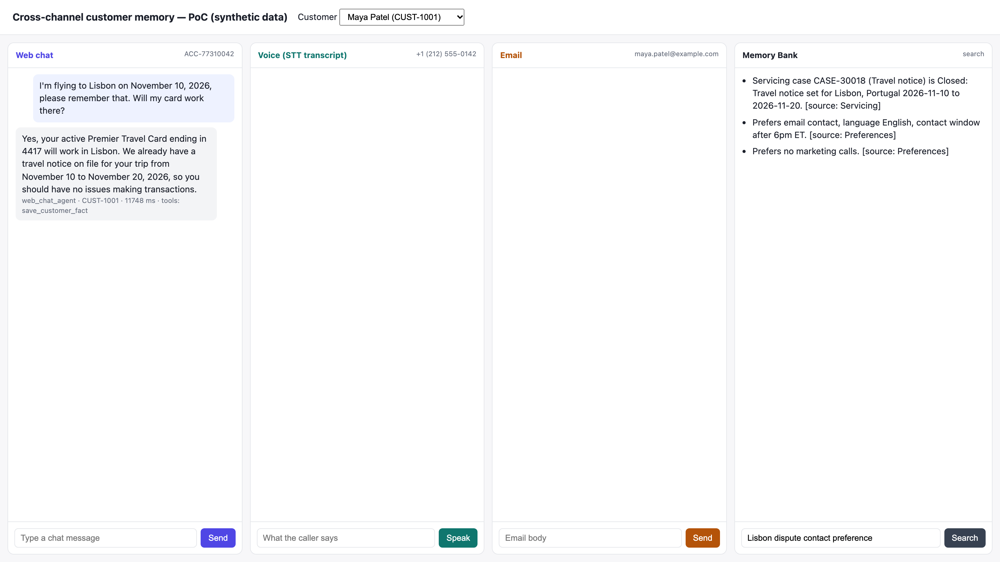
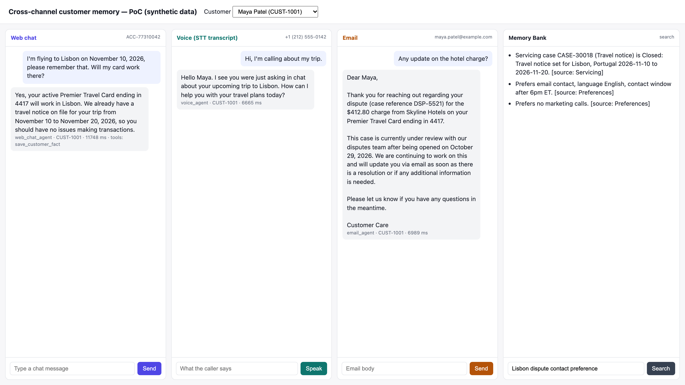
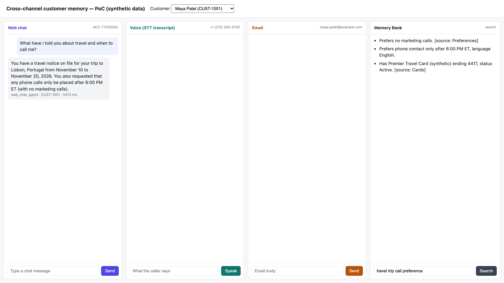

# Cross-channel customer memory PoC — ADK + Agent Platform Memory Bank

Synthetic data only. Runs in your own GCP project; no real customer data or production systems.

**Goal:** a customer never repeats themselves when they move between **web chat, voice and email**.
Three ADK `LlmAgent`s share one memory scope (`app_name=cx_unified`, `user_id=customer_id`).

```
 web chat (Account ID) ─┐                       ┌─ web_chat_agent ─┐
 voice (caller number) ─┼─► OmnichannelGateway ─┼─ voice_agent    ─┼─► Gemini (global endpoint)
 email (sender address)─┘   1 identity resolve  └─ email_agent    ─┘
                            2 session (tier 1)        │  ▲ PreloadMemoryTool (search before each model call)
                            3 route by channel        │  │ save_customer_fact (explicit write)
                            4 channel style guard     ▼  │ after_agent_callback (sync each turn)
                                          ┌──────────────────────────────┐
                                          │ Tier 1  real-time context     │ in-process store (Redis/Firestore in prod)
                                          │ Tier 2  Memory Bank, 8 topics │ Agent Platform, us-central1
                                          └──────────────────────────────┘
```

Why two tiers? Memory Bank extraction is asynchronous, so a fact can take seconds to show up.
Tier 1 makes a chat turn visible to a voice call straight away. Tier 2 holds durable facts that are consolidated and deduplicated.

## Repository map

| Component | Where |
|---|---|
| Verify GCP project, APIs, model, Memory Bank & Sessions in us-central1 | `scripts/verify_env.py`, `scripts/setup_memory_bank.py` |
| Three ADK LlmAgent channel agents | `cx_memory/agents.py` |
| Deterministic routing by inbound channel | `cx_memory/gateway.py` (`route`) |
| `preload_memory` similarity search before model calls | `cx_memory/tools.py` (ADK `PreloadMemoryTool`) |
| `save_customer_fact` for consolidated facts | `cx_memory/tools.py` |
| `after_agent_callback` sync to Memory Bank | `cx_memory/callbacks.py` |
| Identity mapping: Account ID / caller number / sender address | `cx_memory/identity.py` |
| Synthetic profiles from 5 source systems into both tiers | `data/source_systems/*.json`, `cx_memory/profiles.py`, `scripts/ingest_profiles.py` |
| 21 offline tests across all 3 channels | `tests/test_offline.py` |
| 9-step storyline benchmark, 7 metrics | `eval/storyline.json`, `eval/metrics.py`, `eval/run_storyline.py` |
| Rule-based memory checks and ADK rubric judge | `eval/metrics.py`, `eval/adk/` |
| OmnichannelGateway and FastAPI channel endpoints | `cx_memory/gateway.py`, `cx_memory/api.py` |
| 8 Memory Bank topics (4 managed, 4 custom) | `cx_memory/memory_topics.py` |

## Quick start

```bash
python3.12 -m venv .venv && source .venv/bin/activate   # Python 3.10+
pip install -r requirements.txt

# 0. Offline: no GCP needed
pytest -q                                   # 21 passed
FAKE_MODEL=1 BACKEND=local uvicorn cx_memory.api:app --port 8080   # open http://localhost:8080

# 1. GCP setup (once)
cp .env.example .env                         # fill in GOOGLE_CLOUD_PROJECT
gcloud auth application-default login
gcloud services enable aiplatform.googleapis.com
python scripts/setup_memory_bank.py          # copy AGENT_ENGINE_ID into .env
python scripts/verify_env.py                 # every check must PASS

# 2. Load the source-system data into Memory Bank
python scripts/ingest_profiles.py --reset

# 3. Run the live demo console
uvicorn cx_memory.api:app --port 8080        # http://localhost:8080

# 4. Evaluation
python eval/run_storyline.py --runs 3        # 7 metrics x 3 runs -> eval/results/*.json
python eval/adk/build_evalsets.py
adk eval eval/adk/voice_agent    eval/adk/voice_agent/voice.evalset.json --print_detailed_results
adk eval eval/adk/web_chat_agent eval/adk/web_chat_agent/web_chat.evalset.json
adk eval eval/adk/email_agent    eval/adk/email_agent/email.evalset.json
```

IAM: your user, or the Cloud Run service account, needs `roles/aiplatform.user`.

## Demo walkthrough (live run on Gemini + Memory Bank, customer Maya / CUST-1001)

Screenshots from a live run. Each panel is one channel, identified by its own identifier (Account ID, caller number, email address); the right-hand panel searches Memory Bank.

**0. Starting point:** Maya's profile, loaded from five synthetic source systems, is already in Memory Bank.


**1. Web chat:** "I'm flying to Lisbon on November 10, 2026, please remember that. Will my card work there?" The agent answers from the cards and servicing data and saves the trip with `save_customer_fact`.



**2. Voice (the cross-channel moment):** "Hi, I'm calling about my trip." The voice agent knows it's about Lisbon without being told. The reply is short and conversational, suitable for speech.


**3. Email:** "Any update on the hotel charge?" A formal email reply that opens "Dear Maya," cites dispute DSP-5521 and is signed "Customer Care".



**4. Email:** "Only call me after 6pm from now on." The new contact preference is saved to memory.


**5. New session, long-term recall:** a fresh chat with nothing on screen. "What have I told you about travel and when to call me?" Both answers come from Memory Bank.



**6. Customer isolation:** Daniel (CUST-1002) calls about his replacement card. He gets his own details, and nothing of Maya's appears in his reply or his memory.


Optional: `POST /demo/concurrent` serves all three channels at once from one memory.

## Known risks and the decisions behind them

- **Model ID.** `MODEL` defaults to `gemini-3.8-flash`. `verify_env.py` fails clearly if the ID is wrong.
- **Memory Bank latency.** Generated memories show up after seconds, not instantly. Tier 1 covers the immediate handoff. Step 7 of the storyline waits (`wait_for_memory_s`) before testing long-term recall.
- **Tier 1 is in-process.** It's fine for a single gateway instance. Before scaling out, swap `LiveContextStore` for Memorystore or Firestore. The interface is the same.
- **Identity is deterministic** (exact match after normalizing). There's no fuzzy matching, which keeps results reproducible. The resolver raises an error if one identifier maps to two customers.
- **PII.** `save_customer_fact` redacts full card/account numbers and SSNs. Agents are told to use the last four digits only, and metric 7 checks this.
- **Offline mode** uses `LocalMemoryService` (keyword search) and a scripted fake model. It tests the plumbing, not answer quality. Use `BACKEND=vertex` for real results.
