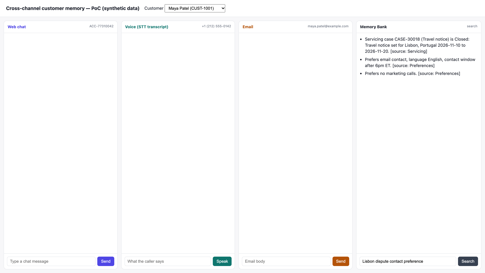
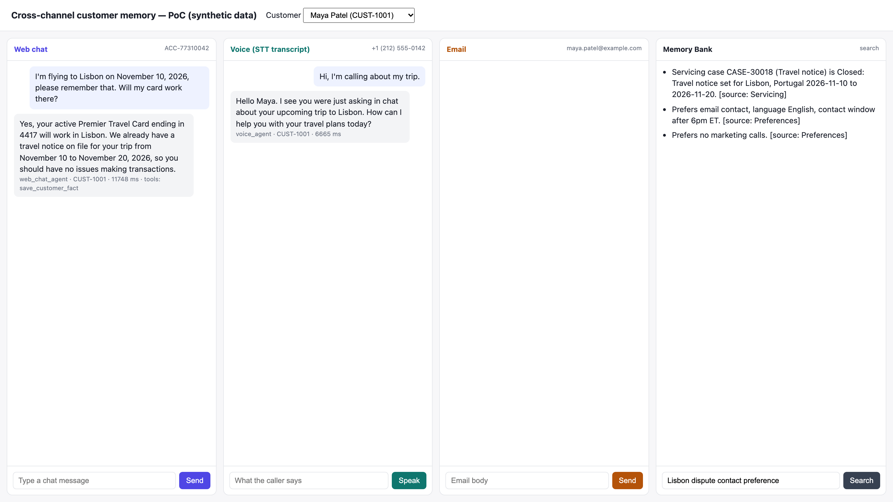
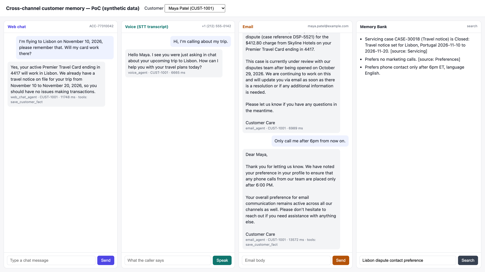
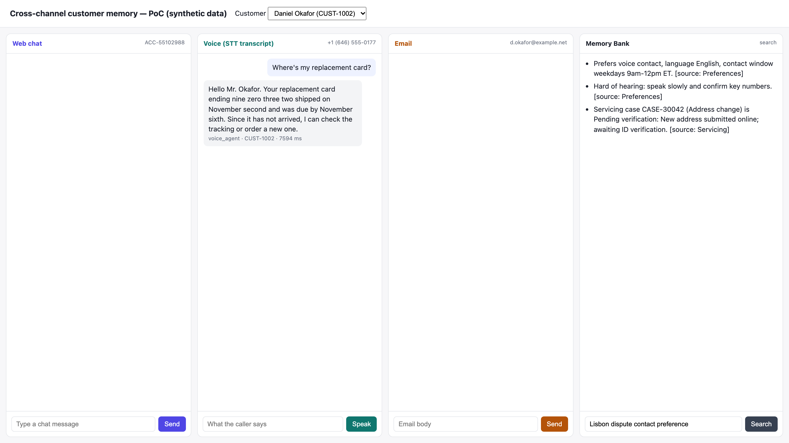

# Cross-channel customer memory PoC — ADK + Agent Platform Memory Bank

Synthetic data only. Runs in your own GCP project; no real customer data or production systems.

**Goal:** a customer never repeats themselves when they move between **web chat, voice and email**.
Three ADK `LlmAgent`s share one governed memory scope per customer (`app_name=cx_unified_<partition>`, `user_id=<customer token>`).

```
 web chat (Account ID, HIGH) ─┐                         ┌─ web_chat_agent ─┐
 voice (caller number, MEDIUM)┼─► OmnichannelGateway ───┼─ voice_agent    ─┼─► Gemini (global endpoint)
 email (sender, MEDIUM) ──────┤   identity + step-up    └─ email_agent    ─┘
 contact center (Connect) ────┘   token vault · partition router   │ ▲ preload_memory / save_customer_fact
                                                                    ▼ │
                       ┌─ GovernedMemoryService ─────────────────────────────────────────────┐
                       │ consent · assurance · redaction · ledger (TTL, supersede) · quotas  │
                       │ extraction policy · timeout · circuit breaker · outbox · audit      │
                       └───────┬────────────────────────────────────────────┬────────────────┘
                 Tier 1 live context (seconds)          Tier 2 Memory Bank: app_name=cx_unified_<partition>,
                                                        user_id=<customer token>, 8 topics, per-topic TTL
   event stream: cx.interaction.v1 (taxonomy, no raw text) · sor.case.updated.v1 · crm.activity.v1
```

Why two tiers? Memory Bank extraction is asynchronous, so a fact can take seconds to show up.
Tier 1 makes a chat turn visible to a voice call straight away. Tier 2 holds durable facts that are consolidated and deduplicated.

## What makes it production-shaped

The demo console runs fourteen scenarios end to end. [docs/SCENARIOS.md](docs/SCENARIOS.md) explains each one: design, code and the production mapping.

| # | Scenario | What it shows |
|---|---|---|
| 1 | Cross-channel handoff | chat → voice → email without repeating anything |
| 2 | Customer calls from a different phone | unknown number → account + one-time passcode to the phone on file → linked as a new device; contact changes need HIGH assurance |
| 3 | Shared household landline | one number, two customers → step-up picks the right one, no cross-customer leak |
| 4 | Contact center → CRM | Connect-style contact event → routing + CRM screen pop with memory provenance → wrap-up logged to CRM and memory |
| 5 | SOR update supersedes memory | dispute resolved in the cards system → event → memory v1 superseded by v2 → every channel answers with the new status |
| 6 | Tokenized customer identity | memory, sessions, events and audit keyed by an HMAC token; audited detokenize |
| 7 | Memory lifecycle | per-topic TTL (trip end + 14 days, resolved + 30 days, ...), expiry sweeper, demo clock |
| 8 | Governance & compliance | Luhn-checked redaction, special-category block, consent withdrawal, legal hold, DSAR export, hash-chained audit |
| 9 | Resilience | Memory Bank down/slow → degraded answers, circuit breaker, outbox replay with idempotency |
| 10 | Cost, throughput, partitions & quotas | extraction policies (per_turn / salient / batched), per-turn cost, burst test, capacity plan, per-partition quotas |
| 11–14 | Client servicing journeys | predicted intent, digital fulfilment, context handoff token from the in-app assistant to live chat or voice, risk-based auth carry-over, proficiency routing, specialist suggested actions, outcome back in the app |

The client journeys and their test data are in `eval/client_use_cases.json` (run: `python eval/run_client_use_cases.py`).

## Repository map

| Component | Where |
|---|---|
| Verify GCP project, APIs, model, Memory Bank & Sessions in us-central1 | `scripts/verify_env.py`, `scripts/setup_memory_bank.py` (8 topics + TTL config) |
| Three ADK LlmAgent channel agents | `cx_memory/agents.py` |
| Gateway: identity → assurance → token + partition → session → agent → guard → event | `cx_memory/gateway.py` |
| Identity resolution, assurance levels, shared numbers, step-up (OTP) | `cx_memory/identity.py` |
| Tokenized customer identity (HMAC vault, audited detokenize) | `cx_memory/tokenization.py` |
| Governed memory choke point (wraps Memory Bank) | `cx_memory/governed_memory.py` |
| Redaction, special categories, consent, contact-change rule, hash-chained audit | `cx_memory/governance.py` |
| Memory ledger, per-topic TTL, supersede, expiry, erasure, legal hold | `cx_memory/lifecycle.py` |
| Partitions, token-bucket quotas, per-customer caps | `cx_memory/quotas.py` |
| Extraction policy, cost meter, capacity plan | `cx_memory/cost.py` |
| Timeout, circuit breaker, fault injection, outbox + DLQ | `cx_memory/resilience.py` |
| Event bus (Kafka stand-in) and interaction taxonomy | `cx_memory/events.py` |
| Contact center + CRM connector (screen pop, routing, wrap-up) | `cx_memory/crm.py` |
| Memory-layer burst test | `cx_memory/loadgen.py` |
| `preload_memory` / `save_customer_fact` / `after_agent_callback` | `cx_memory/tools.py`, `cx_memory/callbacks.py` |
| Synthetic profiles from 5 source systems | `data/source_systems/*.json`, `cx_memory/profiles.py`, `scripts/ingest_profiles.py` |
| FastAPI endpoints and scenario console | `cx_memory/api.py`, `cx_memory/static/demo.html` |
| Digital assistant (dialog manager + LLM fallback), context store + handoff tokens, servicing systems | `cx_memory/digital.py`, `cx_memory/context_store.py`, `cx_memory/servicing.py` |
| Client journeys: test data, runner | `eval/client_use_cases.json`, `eval/run_client_use_cases.py` |
| 48 offline tests (21 core + 22 scenario + 5 client journeys) | `tests/test_offline.py`, `tests/test_scenarios.py`, `tests/test_client_journeys.py` |
| 9-step storyline benchmark, 7 metrics | `eval/storyline.json`, `eval/metrics.py`, `eval/run_storyline.py` |

## Quick start

```bash
python3.12 -m venv .venv && source .venv/bin/activate   # Python 3.10+
pip install -r requirements.txt

# 0. Offline: no GCP needed
pytest -q                                   # 48 passed
FAKE_MODEL=1 BACKEND=local uvicorn cx_memory.api:app --port 8080   # open http://localhost:8080, pick a scenario, Run

# 1. GCP setup (once)
cp .env.example .env                         # fill in GOOGLE_CLOUD_PROJECT
gcloud auth application-default login
gcloud services enable aiplatform.googleapis.com
python scripts/setup_memory_bank.py          # copy AGENT_ENGINE_ID into .env
python scripts/verify_env.py                 # every check must PASS

# 2. Load the source-system data into Memory Bank
python scripts/ingest_profiles.py --reset

# 3. Run the live demo console
uvicorn cx_memory.api:app --port 8080        # http://localhost:8080

# 4. Evaluation
python eval/run_storyline.py --runs 3        # 7 metrics x 3 runs -> eval/results/*.json
python eval/adk/build_evalsets.py
adk eval eval/adk/voice_agent    eval/adk/voice_agent/voice.evalset.json --print_detailed_results
adk eval eval/adk/web_chat_agent eval/adk/web_chat_agent/web_chat.evalset.json
adk eval eval/adk/email_agent    eval/adk/email_agent/email.evalset.json
```

IAM: your user, or the Cloud Run service account, needs `roles/aiplatform.user`.

## Baseline walkthrough (live run on Gemini + Memory Bank, customer Maya / CUST-1001)

Screenshots from a live run of the baseline flow (scenario 1) in the earlier, simpler console. Each panel is one channel, identified by its own identifier (Account ID, caller number, email address); the right-hand panel searches Memory Bank.

**0. Starting point:** Maya's profile, loaded from five synthetic source systems, is already in Memory Bank.



**1. Web chat:** "I'm flying to Lisbon on November 10, 2026, please remember that. Will my card work there?" The agent answers from the cards and servicing data and saves the trip with `save_customer_fact`.


**2. Voice (the cross-channel moment):** "Hi, I'm calling about my trip." The voice agent knows it's about Lisbon without being told. The reply is short and conversational, suitable for speech.



**3. Email:** "Any update on the hotel charge?" A formal email reply that opens "Dear Maya," cites dispute DSP-5521 and is signed "Customer Care".


**4. Email:** "Only call me after 6pm from now on." The new contact preference is saved to memory.



**5. New session, long-term recall:** a fresh chat with nothing on screen. "What have I told you about travel and when to call me?" Both answers come from Memory Bank.


**6. Customer isolation:** Daniel (CUST-1002) calls about his replacement card. He gets his own details, and nothing of Maya's appears in his reply or his memory.



Optional: `POST /demo/concurrent` serves all three channels at once from one memory.

## Known risks and the decisions behind them

- **Model ID.** `MODEL` defaults to `gemini-3.8-flash`. `verify_env.py` fails clearly if the ID is wrong.
- **Memory Bank latency.** Generated memories show up after seconds, not instantly. Tier 1 covers the immediate handoff. Step 7 of the storyline waits (`wait_for_memory_s`) before testing long-term recall.
- **In-process stores.** Tier 1, the ledger, outbox, audit log and event bus live in the gateway process. That's fine for one instance. Each has a named production store in [docs/SCENARIOS.md](docs/SCENARIOS.md).
- **Identity is deterministic** (exact match after normalizing), with assurance levels and step-up instead of fuzzy matching. Shared identifiers are never guessed.
- **PII.** Redaction (Luhn-checked cards, SSN, accounts, phones, emails) runs before anything reaches Memory Bank. Memory is keyed by token, and names are not copied into memory. Regex redaction stands in for Cloud DLP.
- **Prices are illustrative.** Set `PRICE_*` from your rate card before quoting cost numbers.
- **Offline mode** uses keyword search and a scripted fake model. It tests the plumbing and the policies, not answer quality. Use `BACKEND=vertex` for real results.
